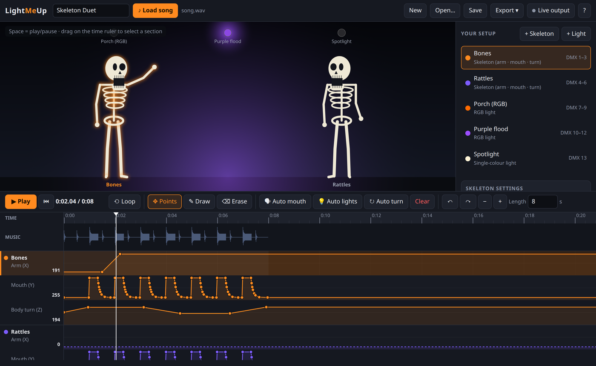
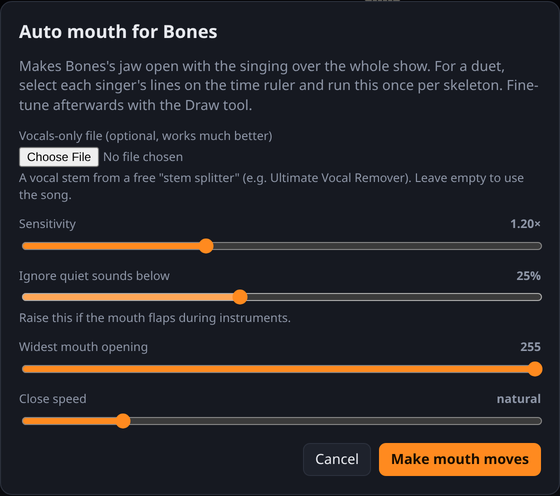

<p align="center"></p>

<h1 align="center">LightMeUp</h1>

<p align="center">
  A point-and-click show builder for animatronic skeletons and exterior lights.<br>
  Program singing props to music, watch the show on screen, then play it on the same gear as a Christmas light display.
</p>

<p align="center">
  <a href="https://github.com/pascalseguin/lightmeup/actions/workflows/ci.yml"></a>
  <a href="https://github.com/pascalseguin/lightmeup/releases/latest"></a>
  <a href="LICENSE"></a>
</p>



## Features

- **Automatic lip sync.** Each skeleton's jaw opens and closes with the singing. Use a vocals-only stem for the best
  results. For duets, select one singer's lines and run it once per skeleton.
- **Lights on the beat.** Flash on every kick drum, chase between lights, or follow the loudness.
- **Lifelike motion.** Random "looking around" turns or a steady sway.
- **Easy hand editing.** Click to add a point, drag to move it, right-click to delete it, or paint movement freehand.
  You can also pause and set a pose with sliders. Undo and redo work everywhere.
- **Live preview.** Cartoon skeletons and glowing lights play along with the song.
- **Live output.** Sends E1.31/sACN to real props while you edit, which is handy for calibrating servo limits.
- **Exports.** `.fseq` for Falcon Player (FPP) and xLights-style playback, a channel map / wiring sheet, and CSV.
- **Receivers included.** Arduino (wired DMX) and ESP32 (WiFi sACN) sketches that drive three servos per skeleton.
- **Runs offline in any browser.** There are no accounts and nothing is sent to the cloud.

## Download

Get the latest version from the **[Releases page](https://github.com/pascalseguin/lightmeup/releases/latest)**.

| System | File | Install |
|---|---|---|
| Windows 10/11 | `LightMeUp-Setup-…-windows-x64.exe` | Run it. The installer isn't code-signed yet, so Windows may say "Windows protected your PC": click **More info → Run anyway**. |
| Windows, no install | `LightMeUp-…-windows-x64-portable.zip` | Unzip and run `LightMeUp.exe`. |
| Ubuntu, Debian, Mint, Raspberry Pi OS | `lightmeup_…_all.deb` | `sudo apt install ./lightmeup_…_all.deb`, then open **LightMeUp** from the app menu. |
| Any other Linux (x86-64) | `LightMeUp-…-x86_64.AppImage` | `chmod +x`, then double-click. |

LightMeUp opens in your web browser. A small console window stays open while it runs; close it to quit.

**From source:** any OS with Python 3.8+ works. Nothing needs to be installed.

```bash
git clone https://github.com/pascalseguin/lightmeup.git
cd lightmeup
python3 server.py --open
```

You can also just open `app/index.html` in a browser. Everything works except live output.

## How it works

Each skeleton is a small **DMX receiver**: an Arduino or ESP32 that reads three channels and turns them into servo
positions.

| Channel | Axis | Moves | Values |
|---|---|---|---|
| start | X | arm | 0 = down, 255 = up |
| start + 1 | Y | mouth | 0 = closed, 255 = open |
| start + 2 | Z | body turn | 0 = left, 128 = centre, 255 = right |

Lights are **RGB** (3 channels) or a **dimmer** (1 channel). LightMeUp assigns channels, warns about overlaps, and
prints a channel map with the `START_ADDRESS` to set in each receiver.

```
song ──▶ LightMeUp ──▶ .fseq on Falcon Player ─┐
             │                                  ├──▶ DMX / E1.31 ──▶ Arduino / ESP32 ──▶ servos
             └──────▶ live sACN (server.py) ────┘
```

### Building a show

1. Add a skeleton for each animatronic and a light for each fixture (right-hand panel).
2. **♪ Load song.**
3. **🗣 Auto mouth**, **💡 Auto lights** and **↻ Auto turn** do most of the work. To apply one to a single section,
   drag across the time ruler first.
4. Fine-tune with points, the ✎ Draw tool, or the pose sliders. Press `Space` to play.
5. **Export ▸ .fseq** and upload it to FPP with the song. **Save** keeps an editable project file.



Auto mouth filters the audio to the voice band and opens the jaw in proportion to the vocal loudness, with a quick
open and a natural close. On a single-servo jaw it looks convincing from the street, and the result is ordinary
keyframes you can edit. A free stem splitter such as [Ultimate Vocal Remover](https://github.com/Anjok07/ultimatevocalremovergui)
or [Demucs](https://github.com/facebookresearch/demucs) makes a clean vocal track.

## Live output

```bash
python3 server.py --open                          # multicast, universe 1
python3 server.py --target 192.168.1.50 --open    # unicast to one controller
python3 server.py --universe 2 --bind 0.0.0.0     # serve to other devices on your network
```

Turn on **Live output** in the editor. Playing, scrubbing and moving the pose sliders now drive the real props. The
`.deb` also installs an optional systemd service (`sudo systemctl enable --now lightmeup`).

> The bridge has no login. Anyone who can reach its port can send DMX to your show network, so keep it on
> `127.0.0.1` (the default) or a trusted LAN. Don't expose it to the internet.

## Receivers

| Sketch | Board | Link | Libraries |
|---|---|---|---|
| [`skeleton_dmx_receiver`](arduino/skeleton_dmx_receiver/skeleton_dmx_receiver.ino) | Arduino Uno / Nano + MAX485 | wired DMX | DMXSerial |
| [`skeleton_sacn_esp32`](arduino/skeleton_sacn_esp32/skeleton_sacn_esp32.ino) | ESP32 | WiFi E1.31 | ESPAsyncE131, AsyncUDP, ESP32Servo |

Set `START_ADDRESS` from the channel map, and set each servo's angle limits so it never hits its end stops. Both
sketches smooth the motion and return to a rest pose if the signal stops. Power the servos from their own 5–6 V
supply and connect the grounds together.

## Project status

| Part | Status |
|---|---|
| Editor, preview, auto tools, exports | Working; covered by tests |
| Live sACN bridge | Working; packet format tested |
| `.fseq` export | Follows the FSEQ v1 format; not yet confirmed on a physical FPP |
| Arduino / ESP32 sketches | Draft; not yet verified on real servos |

Reports from people running real hardware are very welcome. See [CONTRIBUTING.md](CONTRIBUTING.md).

## Development

```text
app/          the editor (plain HTML/JS, no build step); core.js holds the data model and exports
server.py     web server + E1.31/sACN bridge (Python standard library only)
arduino/      receiver sketches
packaging/    installer build script, Inno Setup script, icons, systemd unit
tests/        node --test tests/core.test.js   and   python -m unittest discover tests
```

Release packages are built by GitHub Actions when a `v*` tag is pushed (see `packaging/build.py`).

## License

[MIT](LICENSE) © Pascal Seguin and contributors. Inspired by a friend's singing-skeleton Halloween display.
